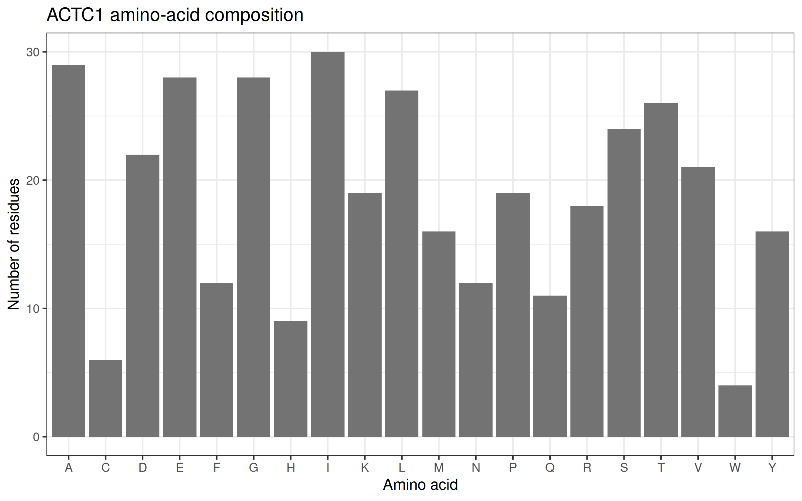

# Muscle-Contractility-ACTC1

## (a) Assignment
- **Assignment number:** 2
- **Gene:** ACTC1 (actin alpha cardiac muscle 1)
- **Transcript:** NM_005159.5 (RefSeq, MANE Select)
- **Variant:** c.301G>A (p.Glu101Lys)
- **ClinVar Variation ID:** 18331
- **NCBI Gene ID:** 70 (chromosome 15)
- **Protein:** NP_005150.1

## (b) Research question
How might the E101K change in cardiac alpha-actin affect thin-filament function and calcium regulation, and what does the evidence say about its link to cardiomyopathy?

## (c) Methods
1. Made the project folder `Muscle_Contractility_ACTC1` with `data`, `results` and `figures` subfolders. I used Posit Cloud (RStudio in a browser).
2. Installed the packages with `install.packages(c("rentrez", "ggplot2"))` and loaded them with `library()`.
3. Set the assignment values: `gene_symbol <- "ACTC1"`, `transcript_accession <- "NM_005159.5"`, `clinvar_id <- "18331"`, `variant_protein <- "p.Glu101Lys"`.
4. Searched NCBI Gene for ACTC1 in humans (txid9606) with `entrez_search()`, then checked the exact gene symbol with `entrez_summary()`. Saved `results/gene_summary.txt`.
5. Downloaded the transcript NM_005159.5 with `entrez_fetch(db = "nuccore")`, extracted the NP_ accession from the GenBank record, and downloaded the protein FASTA with `entrez_fetch(db = "protein")`. Saved `data/ACTC1_protein.fasta` and `results/protein_accession.txt`.
6. Counted the 20 standard amino acids, saved `results/amino_acid_composition.csv`, and made a bar chart with `ggplot2` and `ggsave()`.
7. Checked that residue 101 of the retrieved protein is Glu (E) with `substr(sequence, 101, 101)`.
8. Opened ClinVar record 18331 and recorded the classification, review status, submissions and citations.
9. Made a variant-position plot in R (Option A) with `ggplot2` showing residue 101 along the reference protein.
10. Read published studies on the variant for the mechanism section.

**Errors I corrected:**
- Pasting code from the PDF merged separate commands onto one line and changed straight quotes to curly quotes, which gave "unexpected symbol" and "unexpected '='" errors. I put each command on its own line and retyped the quotes.
- `variant_protein` still held the example value `p.Val165Met`. I changed it to `p.Glu101Lys`.
- The `data` folder was empty after the first failed run. I reran the fixed Step 3 code and confirmed the FASTA with `list.files("data")`.

## (d) Results and figures

*Figure 1* shows the amino-acid counts of the reference protein.

*Figure 2* shows the position of residue 101 along the protein. The marker shows a sequence location only. It is not proof of altered molecular interactions.
